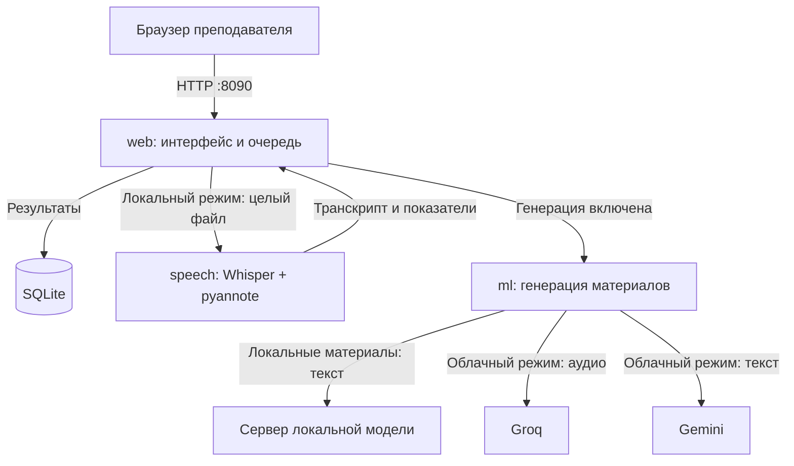

# Сервисы и связи

LEctern состоит из трёх сервисов. Веб принимает файл и хранит результат. Сервис speech обрабатывает речь локально. Сервис ml создаёт учебные материалы и обслуживает облачный режим.

Стрелки к провайдерам относятся к разным режимам. В локальном режиме speech не вызывает Groq или Gemini. [Выбор режима](../guides/materials.md) определяет, какие данные покидают машину.

[Открыть интерактивную карту](../assets/diagrams/architecture.html){ .md-button }

В карте можно выбирать сервисы и прослеживать связи. Она открывается отдельной страницей; подписи русские, элементы управления просмотрщика английские.

## Границы ответственности

| Сервис | Отвечает за | Хранение |
|---|---|---|
| web | Гостевые сессии, загрузка, очередь, история, интерфейсы преподавателя и ученика | SQLite и временные загрузки |
| speech | Подготовка аудио, распознавание, разделение говорящих, роли, числовая аналитика | Кеш моделей и временная папка запроса |
| ml | Генерация конспектов и тестов; облачная транскрибация | Очередь в памяти, временные файлы |

## Очереди

Веб регистрирует задание в SQLite и запускает фоновую обработку в своём процессе. В Compose одновременно выполняется одна веб-генерация. Отдельного брокера сообщений сейчас нет.

Сервис speech обрабатывает одну запись за раз. Сервис ml использует отдельные очереди распознавания и анализа в памяти процесса. При перезапуске ml его очередь не восстанавливается из SQLite веба.

## Сеть

Наружу опубликован только веб: 127.0.0.1:8090 по умолчанию. Внутри Compose доступны speech:8000 и ml:8000. Ключ ML_API_KEY в вебе совпадает с API_KEY сервиса ml.

Гостевая сессия ограничивает доступ к истории. Это не система учётных записей школы; правила общего доступа и аутентификацию нужно определить до развёртывания для группы пользователей.
