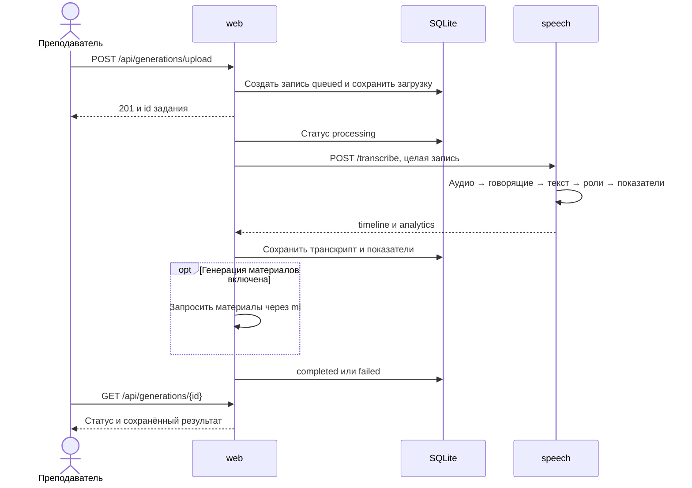
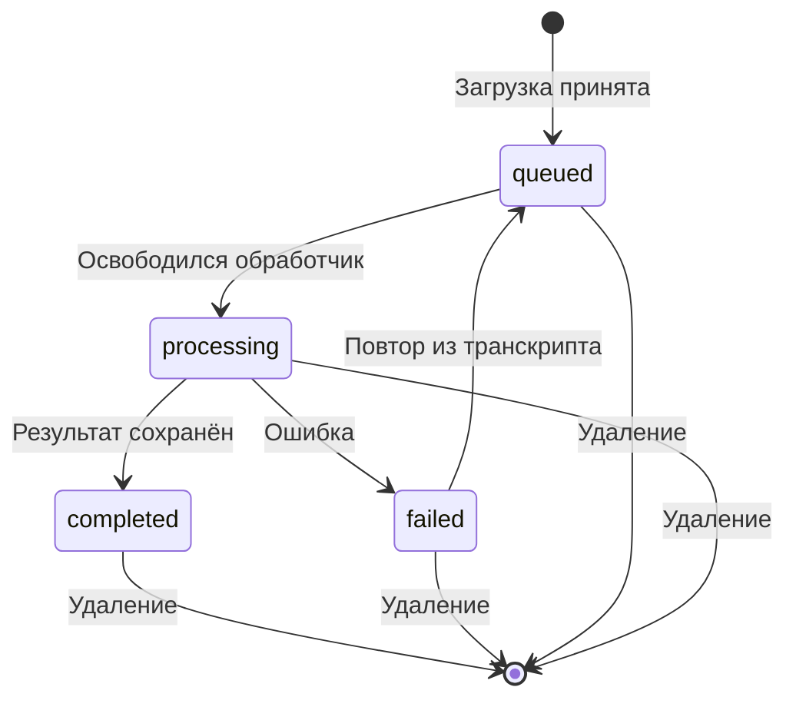

# Обработка записи

## Локальный запрос

Веб отвечает на загрузку идентификатором задания. Долгая обработка выполняется в фоне, а браузер получает обновления через WebSocket и API истории.

Сервис speech возвращает таймкоды в секундах. Веб переводит их в миллисекунды и сохраняет начало, конец, говорящего и роль. Разделение говорящих выполняется на всей записи; веб не делит её на независимые локальные запросы.

## Статусы веб-задания

Схема показывает успешное удаление. Ограничение при наличии ответов учеников описано в [правилах хранения](../operations/data.md).

В сервисе ml другой набор статусов: queued, running, succeeded и failed. Идентификатор задания ml не совпадает с идентификатором занятия в вебе.

## Перезапуск и отмена

При запуске веб ищет незавершённые записи. Если транскрипт уже сохранён, он повторяет завершающий этап. Если остался загруженный файл, он повторяет обработку. Без файла и транскрипта задание завершается ошибкой.

Удаление отменяет веб-задачу. Отключение клиента не гарантирует немедленной остановки вычислений в speech: рабочий поток нельзя безопасно прервать посреди распознавания. Сервис очищает временную папку после завершения обработки запроса.
